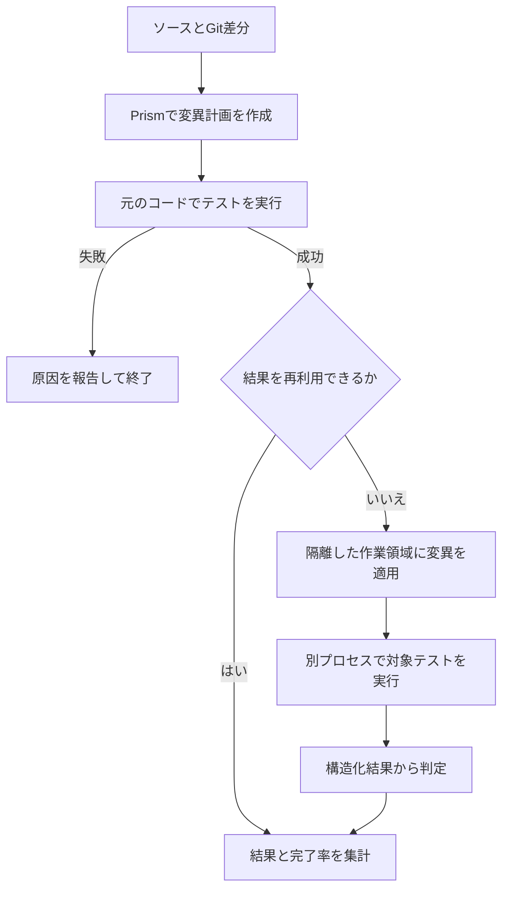

# henniの設計 — Prismを基盤にRuby・Railsのテストを検証する

作成日: 2026-11-18（日本時間）  
対象: https://github.com/s4na/henni  
状態: Ruby＋RSpecの最初の実装は[README](../README.md)の手順で実行できます。以下は後続段階を含む設計です。

## この設計で決めること

PrismでRubyの変異を作り、RSpec／Minitestで検出できるかを確かめる単一のgemを開発する。まずRuby＋RSpecの最小実装を完成させ、Rails、Minitest、PR差分実行、速度改善の順で広げる。未完了や実行環境の障害をテストの成功に混ぜないことを、全段階で共通の契約にする。

- [構成と責務](#3-実行全体の構造)
- [変異生成](#4-prismでの変異生成)と[実行環境の隔離](#5-実行方式とrailsの隔離)
- [判定](#6-テスト結果をどう判定するか)、[テスト選択](#7-テスト選択は段階的に導入する)、[差分とキャッシュ](#8-prの差分テスト変更キャッシュ)
- [CLI](#9-cliと設定の契約)と[レポート](#10-レポートの契約)
- [実装順序](#11-開発の順序と受入れ条件)、[検証](#12-検証で潰したい具体的な故障)、[ライセンス](#13-参考元とライセンス)

## 1. 提案する方向

**Ruby 4.0を主な開発環境、Ruby 3.4を互換対象とし、Prism 2.1以降の2.xで変異を生成するRuby gemを作る。Rails 8.1、RSpec、Minitestを順に対応させ、GitHub ActionsでPRごとに変更範囲を検証する。**

利用者が知りたいのは、どの変更がテストに検出されないか、その結果を信頼できるかである。最初の成功条件を次のように置く。

- 意図的に弱くしたテストでは変異が生き残り、境界値のassertionを追加すると同じ変異を検出できる。
- 起動失敗、DB障害、時間切れ、未実行を、検出成功として数えない。
- 元の作業ディレクトリを変異で変更せず、各変異は元のソースから独立に作る。
- 同じ入力・同じseedでは、単独実行と並列実行で同じ判定になる。
- PRの変更範囲、実行したコミット、実行完了率を結果から確認できる。
- Ruby/Railsの更新を、対応組合せのCIで継続検証できる。

速度は測定して改善する。Prismの採用だけでRailsテストの総時間が短くなるとは仮定しない。対象選択、テスト選択、起動回数、並列度、結果再利用が主な改善点になる。

## 2. 最新情報と採用判断

2026-11-18時点の一次資料に基づく。バージョン更新時は、以下の対応目標とfixtureを合わせて更新する。[^S1][^S2][^S3][^S7][^S8]

| 論点 | 確認した事実 | この設計での選択 |
|---|---|---|
| Rubyのパーサー | PrismはRuby 3.3で同梱され、3.4で既定パーサーになった | Prismを直接使う |
| Prism | 2.1.0が2026-10-28に公開されている | gem依存を `prism ~> 2.1` とし、開発用lockfileで検証版を固定 |
| Rubyの保守 | 4.0・3.4は通常保守。3.3はセキュリティ保守、3.2はEOL | 初期の正式対応目標はCRuby 3.4 / 4.0 |
| Rails | 現行公開ガイドは8.1.4.1 | 初期の正式対応目標はRails 8.1 |
| 実行環境 | パーサーが読める構文と、実行中Rubyが実行できる構文は別 | 解析とテストを対象アプリと同じRuby・bundleで行う |
| Ruby Box | 公式文書上experimentalで、ActiveSupport等の既知問題がある | 初期の実行方式には採用しない |

`~> 2.1` は2.1以上・3.0未満を意味する。Prism更新PRではASTと位置情報の契約テストを通す。最小依存版2.1.0と、その時点の最新2.xをCIで確認する。Ruby本体への同梱版だけに依存しない。

古いRuby対応は、利用したいアプリが具体化した時点で別途判断する。Prism 2.1自体のRuby起動要件が2.7以上であることは、ツール全体の互換性を保証しない。[^S3]

### 既存ツールとの関係

Rubyのミューテーションテストには、[Mutineer](https://github.com/davidteren/mutineer)、[Evilution](https://github.com/marinazzio/evilution)、[Mutant](https://github.com/mbj/mutant)などの先行実装がある。PrismやRails対応を採用することだけを独自性とはしない。henniでは、判定不能の明示、Railsの状態隔離、入力を検証する結果再利用、PRで原因を追えるレポートを一貫した契約として実装する。

これらは機能比較の参照先とし、本設計は既存ツールより高速・高精度であるとは主張しない。参考元として使うコードと、そのライセンスの扱いは[13節](#13-参考元とライセンス)に定める。

## 3. 実行全体の構造

以下は提案する処理の流れである。



最初の実行方式では、**一つの変異につき新しいRubyプロセスを起動する**。並列化する場合も、異なる変異を異なるプロセスと作業領域に分ける。一つの実行で同時に有効な変異は一つだけである。

初期段階は一つのgemの中で責務を分ける。多言語の別サービスや独立した複数gemに分割する必要はない。

| 部品 | 責務・入力と出力 | 境界 |
|---|---|---|
| SourceSnapshot | 対象ファイル、設定、テスト入力を一回のrun用に固定する | ファイルI/O |
| PrismFrontend | ソースを解析し、変異箇所・byte範囲・置換候補を返す | Prism APIをここに集約 |
| Planner | 変異ID、対象範囲、実行順序、再利用可否を決める | テストを実行しない |
| Workspace | 元コードを保ったまま変異したファイルを用意する | ファイルI/O |
| Executor | 子プロセス、時間制限、キャンセル、実行資源を管理する | OSへの依存 |
| RunnerAdapter | RSpec / Minitestの発見・選択・実行結果を統一する | テストフレームワークへの依存 |
| ResultStore / Reporter | 構造化結果を保存し、CLI・JSON・GHA Summaryへ出力する | データ形式を版管理 |

`Henni`名前空間の下に上記の部品を置く。公開の入口はCLIと版管理したJSONに絞り、内部クラス名・メソッドを安定APIとして約束しない。

`Mutation`、`RunContext`、`TestSelection`、`MutationResult`は小さな値オブジェクトにする。必要な境界をRBSで記述する案はあるが、型検査の導入をMVP完成の前提にはしない。

## 4. Prismでの変異生成

### 4.1 ASTは場所を特定するために使う

ASTは、比較・条件・リテラルなどを表す構文木である。PrismのASTを使って変異できる演算子を見つけ、その位置に対応する元ソースのbyte範囲だけを置き換える。

例えば次の変異を生成する。

```ruby
# 元のコード
price >= 1_000

# 一つの変異
price > 1_000
```

最初の演算子は、比較の境界変更、等値／不等値の反転、真偽値の反転、整数の境界変更、条件の固定などに絞る。Rubyの新構文を解析できることと、すべてのASTノードに変異規則を実装することは分ける。

初期の変異対象はRubyのメソッド本体とする。Railsのcallback・validation宣言の削除、DB schema、ERBの変異は後から追加を判断する。

### 4.2 生成時の契約

- 元ソースはバイト列として保持し、元encodingとmagic commentを維持する。
- Prismの `start_offset` / `length` はバイト単位なので、文字列の文字indexと混ぜない。[^S4]
- 比較演算子など、必要なtoken位置だけを書き換える。コメントや無関係な空白を再生成しない。
- 対象アプリと同じRubyで `Prism.parse(..., version: "current")` を使う。未対応構文バージョンなら明示的に停止する。[^S5]
- 元ソースの解析失敗は入力エラーである。変異生成後も再解析し、成功を確認する。ASTが返るだけでは成功とはしない。
- 変異後の構文エラーは `invalid` として記録する。テストが変異を検出した件数には含めない。
- 元と同じ置換や、同じ範囲に同じ置換を行う重複候補は除く。
- 初期演算子は改行を維持する。将来改行を変える演算子では、元位置と変異後位置の対応情報を必須にする。

heredoc、UTF-8の日本語、別encoding、複数行式、pattern matching、endless method、番号付き引数、`it`について、解析と位置情報のfixtureを用意する。新構文を含むファイルを安全に扱えることを検証する。

### 4.3 IDとキャッシュキーを分ける

変異の識別子は、プロジェクト相対パス、メソッド等のscope、AST上の経路、演算子の種類、置換内容から決める。絶対パスや行番号だけをIDにしない。

ただし、AST内への挿入や同名メソッドの再定義によりIDは変わり得る。全編集で不変とは約束しない。重複scopeや曖昧な照合では新しいIDとして扱う。

**同じIDは、過去の結果を再利用してよいという意味ではない。** 入力内容、実行環境、テスト選択条件のfingerprintは別に保存・検証する。

## 5. 実行方式とRailsの隔離

### 5.1 最初の正本はspawn方式

run開始時の入力から変更されない基準snapshotを作り、baselineと各変異用の作業領域を作る。初期実装ではコピーを使い、同じsnapshotの作成を繰り返さない。各変異の作業領域は独立させる。

コピーの費用が大きければ、計測後にcopy-on-writeの複製や、状態を完全に復元できるworker再利用を検討する。元ソースを書き換える可能性のある共有hard linkは使わない。

子プロセスを起動する前にファイルへ変異を適用する。これにより、Railsの通常の起動・autoload・requireで変更後のファイルを読み込ませる。読み込み済みのメソッドだけを後から差し替える方式を標準にしない。

- `cwd`、`BUNDLE_GEMFILE`、ロードパスは隔離先へ向ける。
- 元ディレクトリを指す絶対パスやsymlinkで変異が迂回されないか検証する。
- run中の元ソース変更は次のrunへ回す。途中でsnapshotへ混入させない。
- bundleの依存gemを共有する場合も、実行中に変更しない前提を持つ。
- path依存gem、monorepo、外部ファイルは入力manifestに含める。対応できない配置を黙って元ディレクトリから実行しない。
- targetファイルの適用後digestを子側で照合する。これとロード先の確認を、単なる終了コードから独立した適用確認として記録する。
- baselineとmutantで同じseed・環境・起動経路を使う。
- Unixでは子プロセス群を独立したprocess groupに入れ、期限超過・キャンセル時に終了要求、猶予後の強制停止、回収まで管理する。子プロセスを残したまま次の変異へ進めない。

初期の互換性検証環境はLinuxとmacOSとする。Windowsは、子プロセス群の停止・パス・encoding等の検証が揃ってから正式対応する。

### 5.2 Railsでは外部状態も分ける

新しいRubyプロセスでも、同じDBやRedisへ書き込めば状態は共有される。Railsアダプターでは以下を契約にする。

| 状態 | 隔離の方針 |
|---|---|
| Rubyの定数・グローバル変数・ロード済みコード | 変異ごとに新しいプロセス |
| SQLiteのDBファイル | 同時実行workerごとに専用ファイル |
| PostgreSQL / MySQL | workerごとに専用test database等を用意し、アプリ側のsetup hookで接続する |
| DBの内容 | transactional test等で復元。保証できない場合は変異ごとに初期状態へ戻す |
| Redis / cache | 変異ごとのnamespace、または各変異の前に確実に初期化。保証できない構成は、逐次実行を含めて未対応とする |
| tmp / log / Bootsnap等 | 変異ごとの領域。baseline由来のコンパイル済みキャッシュを共有しない |
| 外部job worker / 別サーバー | 初期対応では対象外。テスト用adapterへの切替または観測不能の明示 |
| テストランナー自身の並列実行 | 初期は無効。ミューテーション側だけがworker数を管理 |

Railsの初期CI fixtureにはSQLiteを使い、外部サービスの準備を必須にしない。PostgreSQL / MySQLの正式対応は実DBを使ったfixtureを追加してから表明する。

### 5.3 後から評価する実行方式

| 候補 | 期待する効果 | 採用する条件 |
|---|---|---|
| spawn＋差し替え済みファイル | 正しいロード経路と状態隔離を作りやすい | 最初の実行方式 |
| fork / preload | Railsの起動時間を共有できる可能性 | 読み込み済みtarget、DB接続、thread、外部状態を処理し、spawnと判定が一致する |
| mutation switching | 複数の変異候補をソースへ埋め込み、実行ごとに一つを選ぶ | 評価順、scope、return/break/next、autoloadが変わらず、実測効果がある |
| Ruby Box | プロセス内の定義を分離できる可能性 | Rails互換性と外部状態の扱いを検証し、実験的機能への依存を引き受けられる |
| Ractor / JIT | 一部処理の並列化・高速化の可能性 | 実測で支配的な費用に効く場合のみ。初期の隔離設計の前提にしない |

Rubyでインメモリ変異が原理的に不可能なわけではない。参考元のVite / Vitestのロード機構を、そのままRailsへ使うことはできないという区別である。[^S10]


## 6. テスト結果をどう判定するか

baselineは、変異を入れていない同じsnapshot・同じ環境のテスト実行である。最初は設定されたテスト全体を実行する。これが失敗、0件、時間切れなら、そのrunの変異判定を開始しない。

RSpec / Minitestアダプターは、実行開始・テストID・成功／失敗・実行終了を構造化データとして返す。stdoutの文字列や終了コードだけから推測しない。

| 状態 | 判定条件 | スコアへの扱い |
|---|---|---|
| killed | 適用確認済みで、有効なテストのassertion失敗等を観測 | 検出成功 |
| survived | 必要な選択テストがすべて正常に完了し、成功した | 未検出 |
| uncovered | 測定が完全なbaselineで到達テストがないと確認できた | 未検出 |
| invalid | 変異のソースが対象構文で成立しない | 対象外。生成件数として別表示 |
| ignored | 理由と対象fingerprintが一致する明示的な除外 | 対象外。除外件数を表示 |
| timeout | 子プロセスまたは変異の期限超過 | 判定不能。killedにしない |
| error | 起動・DB・runner・適用・結果形式などの障害 | 判定不能 |
| pending | 未投入、キャンセル、予算終了等で未確定 | 未完了 |

実行されたtest bodyの例外は、変異が生んだ失敗として扱える場合がある。ただし、既知のインフラ障害や分類できない例外を、種類の推測だけでkilledにしない。必要なら同じ選択テストを元コードで再確認し、結果が不安定なら判定不能とする。

killedは有効な最初のテスト失敗で打ち切れる。survivedは、選択したテストの全件完了が必要である。0件成功や途中終了をsurvivedにしない。

スコアは、対象範囲に対する `killed / (killed + survived + uncovered)` とする。timeout / error / pendingがあれば「暫定値」であり、CI成功にはしない。分母0はN/Aとし、100%に変換しない。

`--ci` の初期方針は、未除外のsurvived / uncoveredがあれば失敗とする。導入時に既存全体の100%達成を要求せず、PRの対象範囲に適用する。閾値方式を後で加える場合も、未完了のrunを合格扱いにしない。

## 7. テスト選択は段階的に導入する

### 7.1 最初は正しい全実行を作る

最初の縦断実装はRSpecと全対象テスト実行で作る。次にテストファイル単位、必要ならexample単位へ狭める。CLIやRunnerAdapterは最初から選択テストのIDを渡せる構造にしておくが、最適化の完成をMVPの前提にしない。

### 7.2 Coverageをテスト対応表にする方法

Ruby Coverageはプロセス全体の測定であり、スレッド別の測定ではない。また、測定開始後にロードされたコードが対象になる。[^S6]

提案する収集方法は以下である。

1. 専用のbaselineプロセスで、アプリをロードする前に `Coverage.start(lines: true)` を実行する。
2. baselineでは同一プロセスのテストを逐次実行する。
3. 各exampleの前後で行の実行回数を取得し、増加した行とexample IDを対応づける。
4. 各example用のbefore / after hookを測定区間に含める。
5. 起動時・suite共通・context共通の実行行を別に保持する。

`oneshot_lines` の累積集合の差だけでは、複数のexampleが同じ行を通ったことを検出できない。初期は通常の実行回数の差を使う。

### 7.3 不完全な対応表の扱い

Rubyの動的ロード、共通hook、別thread、子プロセス、別サーバーの実行を、常に一つのexampleへ帰属できるとは考えない。

- 共通実行に関係する変異は、ファイル単位または設定された全テストへ広げる。
- 対応表のない場所を、自動でuncoveredと判定しない。
- 並列テストや子プロセス等で観測が不完全なら、選択実行を無効化する。
- SimpleCov等とCoverage設定が競合する場合は、互換モードか独立した測定runを使う。既存の測定結果を勝手にclearしない。
- line coverageはASTノードへの厳密な到達証明ではない。余分なテストが選ばれても、選び漏れを避ける。

最適化の採用条件は、fixtureと対象アプリの検証で、全実行と選択実行の判定が一致することである。疑わしい場合の戻り先を全実行として固定する。

選択実行を導入するときは、元コードでも同じ選択集合・順序・seed・hook・初期状態で成功することを必須にする。全テストのbaseline成功だけでは代用しない。例えば別のテストが作る共有状態に依存していると、一部だけ選んだ元コードが失敗することがある。

この確認は同じrun内の同じ入力・選択集合について再利用できる。失敗する選択集合は全実行へ戻し、その状態で変異を再評価する。これにより、選択によるassertion失敗をkilledへ混入させない。

## 8. PRの差分、テスト変更、キャッシュ

### 8.1 差分対象を定義する

PRはheadのソースを実行し、指定されたbaseとheadのmerge-baseから差分を取る。元コードのbaselineも同じheadで実行する。通常の結合テストでは、別途マージ後コミットを検証してよい。[^S12]

初期は変更行そのものだけでなく、変更行を含むメソッド全体を変異対象にする。メソッド外のコードや帰属不能な変更は、対象ファイル全体へ広げる。削除のみのhunkでも、head側に残る周辺メソッド・ファイルへ対応づけ、無言で0件にしない。

| 変更内容 | 初期の実行範囲 |
|---|---|
| Rubyの実装 | 変更が含まれるメソッド、または対象ファイル |
| テスト、fixture、factory、共通helper | 設定された全対象へ拡大 |
| Gemfile.lock、起動設定、Rails initializer、共通設定 | 設定された全対象へ拡大 |
| include対象外の共有Rubyコードやpath依存gem | 依存先を証明できなければ全対象へ拡大 |
| 説明文書のみ | 適用対象なしと報告。ただし文書以外の変更の混在を確認 |
| base / merge-baseを取得できない | 明示的なエラー。空差分として成功しない |

初期にテスト変更で全対象へ広げるのは、どの既存変異が検出されなくなったかを見落とさないためである。将来、完全な対応表を作れた場合に対象を絞る。

対象外の変異は `out_of_scope` として集計から外す。対象内のpendingと混同しない。レポートには要求範囲、実際の範囲、拡大理由を記録する。

### 8.2 結果の再利用は厳密に始める

最初は、以下を含むfingerprintが一致した確定結果だけを再利用する。

- 対象とその周辺を含む実装入力、テスト、fixture、factory、helper
- Gemfile、lockfile、gemspec、path依存、読み込む設定
- Rubyのengine・完全なバージョン・platform、Prism、ツール、runner adapter
- 有効な演算子セット、テスト選択方式、seed、除外設定、実行方式
- schema、外部サービス構成、結果に影響する環境変数やテストデータ、run時点の未commit変更

秘密値をキャッシュへ保存しない。環境変数は明示したもののfingerprintとして扱う。時間、外部API、制御されていないDB等に依存する結果は、入力が一致したと証明できないので再利用を無効にする。

初期のfingerprintはアプリ全体の入力を広く含める。別の実装ファイルを変えただけでも失効するため、関数単位の再利用より効率は落ちる。PRで変異対象自体を絞る効果は得られる。

将来、依存関係を保守的に追える場合に、scope単位のfingerprintへ細分化する。動的呼び出しを静的call graphだけで完全に把握したと見なさない。

IDだけ、行番号だけ、mtimeだけ、GitHub Actionsのcache hitだけを根拠に再利用しない。timeout / error / pendingを確定結果として再利用しない。

baselineはキャッシュ再利用の前にも実行する。これはキャッシュがあっても元テストが壊れていないことを確認するためであり、flaky testや外部入力の完全な検証を保証するものではない。

### 8.3 保存の構造

初期は版管理したJSONと、追記型の実行記録で十分である。SQLite等は計測で必要になってから導入する。

- coordinatorを唯一の書き手にし、workerは結果を返す。
- 完了記録は一時ファイルからrenameして確定する。
- snapshotのschema version、入力fingerprint、source digestを検証する。
- 中断後に再開するときは同じ入力を要求し、確定結果だけを再利用する。
- GHAのgem依存キャッシュと、ミューテーション結果キャッシュを分ける。

## 9. CLIと設定の契約

以下は実装予定のCLI例である。

```bash
bundle exec henni run
bundle exec henni run --since origin/main --ci
bundle exec henni run --only MUTATION_ID
bundle exec henni run --jobs 2 --time-budget 1200
```

`--since` は内部でmerge-baseを計算する。CIではref名よりbaseのcommit SHAを優先する。`--only` は現在の入力から同じIDの変異を再生成し、適用前にdigestを確認する。

設定ファイル名は `henni.yml` とする。`--config` で変更でき、CLI引数、設定ファイル、既定値の順で優先する。未知のキーや不正な型は開始前にエラーにする。以下は実装予定の設定例である。

```yaml
version: 1

source:
  include:
    - "app/models/**/*.rb"
    - "app/services/**/*.rb"
    - "lib/**/*.rb"
  exclude:
    - "vendor/**"
    - "tmp/**"
    - "db/schema.rb"

runner:
  adapter: rspec
  paths: ["spec"]
  seed: 12345

execution:
  strategy: spawn
  jobs: 1
  mutant_timeout_seconds: 60
  time_budget_seconds: 1200

selection:
  mode: all

cache:
  mode: strict

report:
  directory: henni-report
  formats: [text, json, github]
```

`jobs: 1` を初期の既定値とし、複数workerは資源隔離を検証してから有効にする。時間制限は構成例であり、性能保証ではない。Minitestではadapterと対象ディレクトリを切り替える。RailsのDB等はアプリごとのsetup hookで用意する。

設定は文字列・数値等の宣言的な形式に限定する。任意コマンドの文字列をshellへ連結せず、必要な実行はargv配列で扱う。Rake taskを介する場合もadapterの構造化結果を要求する。

| 終了コード | 意味 |
|---|---|
| 0 | 完了し品質ゲートを通過、または適用対象なしを明示 |
| 1 | 判定は完了したが、survived / uncovered等で品質ゲートを通過しない |
| 2 | 設定、baseline、実行、測定、時間切れ、未完了等で結論を出せない |
| 130 | ユーザーまたはCIによる割込み |

初期は品質ゲート失敗より実行不能を優先して返す。途中結果もJSONへ残す。

## 10. レポートの契約

JSONを機械処理の正本にする。CLIとGHA Summaryは同じ結果から作る。

| データ | 主なフィールド |
|---|---|
| RunContext | schema_version、run_id、head_sha、base_sha、merge_base、input_fingerprint、Ruby / Prism / adapterの版 |
| Scope | requested_scope、effective_scope、expansion_reasons、include / exclude、test selection方式 |
| Mutation | mutation_id、relative_path、scope、元位置、operator、before、after、source digest |
| Execution | applied_digest、loaded_target確認、test discovery、expected / started / finished counts、failed test IDs、exit、signal、timeout、duration |
| Verdict | status、reason、cache_hit、diagnostics |
| Summary | planned、decided、pending、各状態数、complete、score、score_scope |

`complete` は、必要なbaselineと適用・測定が有効で、対象内にtimeout / error / pendingが残っていない場合だけtrueにする。invalid / ignoredは理由付きの対象外として区別する。

HTMLは、元コードと変異、失敗・成功したテストを確認する用途で後から追加する。外部CDNを必要としないレポートを基本とする。AI向け専用サービスは作らず、JSONと `--only` で再実行できれば最初は十分である。

同値変異は自動で断定しない。除外する場合はmutation ID、scope fingerprint、理由を記録し、コードが変わった除外をstaleとして再確認する。


## 11. 開発の順序と受入れ条件

| 段階 | 実装すること | 完了の判断 |
|---|---|---|
| 1. gemとCIの土台 | MIT、gemspec、Ruby 3.4 / 4.0のCI、Prism adapter | 両Rubyで解析fixtureとgem packagingが通る |
| 2. Ruby＋RSpecの縦断実装 | 比較演算子等、spawn、baseline、JSON、判定契約 | 弱いテストでsurvived、assertion追加でkilled。起動失敗と時間切れは別状態 |
| 3. Rails 8.1の最初の対応 | 小さなRSpec Railsアプリ、autoload、SQLite、専用workspace | 変異後のコードを読み、DB・tmpが実行間で漏れない |
| 4. Minitest対応 | 共通adapter契約とMinitest Rails fixture | 同じ変異fixtureでRSpec版と意味の対応する判定になる |
| 5. PRでの継続利用 | 差分対象、テスト変更時の拡大、GHA Summary、strict cache | testだけの変更でも再評価。未完了・0件を誤って合格にしない |
| 6. 高速化 | coverage選択、複数worker、実行順序の最適化 | 全実行・単独実行との判定一致と、実アプリでの時間改善 |
| 7. 追加方式の判断 | fork、switching、より細かいcache | spawnとの比較で意味と結果を保ち、維持費に見合う速度効果がある |

[CI設計](ci.md)に従ってGHAは段階1から回す。ミューテーションの自己適用は段階2以降に加える。最初の実装単位は、**「Prismで一つの比較式を変異させ、RSpecで検出し、GHAでその契約を検証する」**ところまででよい。

## 12. 検証で潰したい具体的な故障

網羅的なテスト件数を目標にせず、誤った品質判定と状態混入に直結するものを優先する。

| 故障の例 | 検証すること |
|---|---|
| 元のテストが既に失敗している | 変異判定を始めずbaselineエラーになる |
| runnerのexit 1、DB停止、signal終了 | killedへ混入しない |
| runnerが0件だけ実行した、最終結果が欠落した | survivedにならない |
| ソースに日本語・heredocがある | byte位置の置換で別の箇所を壊さない |
| 前の変異がクラス変数・ファイル・DBを変更した | 次の変異へ残らない |
| autoload後の元ファイルを実行している | 適用・ロード先確認で検出できる |
| テスト・factory・initializer・lockfileだけを変更した | 必要なcache失効と範囲拡大が起きる |
| helperで始まったthread、子プロセスへ処理を渡す | coverageが不完全と分かり、選択を広げる |
| 全テストでは成功するが、選択したテストだけでは元コードも失敗する | 選択集合のbaselineで検出し、全実行へ戻す |
| 予算終了・キャンセル・途中再開 | pendingが残り、未完了を成功にしない |
| 並列実行順が変わる | 同じseedで単独実行と判定が一致する |
| 既存変異の除外対象コードが変わった | 除外がstaleになり自動適用されない |
| gemを配布する | LICENSEと必要な第三者表示がgem内にも存在する |

性能は、純Rubyの小さいgem、Rails service中心のアプリ、DBを使うRailsアプリで計測する。初回、変更なし、メソッド変更、テストだけ変更、共通設定変更を分ける。

記録するのは、wall time、baseline / boot / mutant実行の内訳、実行テスト数、worker数、peak memory、判定の一致、キャッシュhitの件数である。異なる変異集合の総時間だけを比較して高速と結論しない。

## 13. 参考元とライセンス

参考元は `mizchi/mutator`。設計時に参照したcommitは `0aa753eb65f9c35f7b5a99616b4f9381bb841c21` である。[^S10]

取り入れる考え方は、ASTと元ソース範囲による変異、coreとrunnerの分離、位置だけに依存しないID、変更範囲の検証、入力を検証した結果再利用である。Vite / Vitestの実行機構、weak mutationの評価、インメモリ切替はRuby向けに独立して検討する。

参考元のdesign文書には古い案も残っているため、現行READMEとコードを優先する。参考元の性能値をRuby版の見込み値として流用しない。

### ライセンス運用の提案

- 自作部分はMITライセンスとし、配布gemに `LICENSE` を含める。
- READMEに参考元リンクと、参考にした仕組みを簡潔に記載する。
- 調査・移植の記録には、参考元のcommitとファイルを残す。
- コードや文章をコピー・翻訳移植した場合、元の著作権表示とMITのライセンス全文を保持する。
- 実際に再利用したものを `THIRD_PARTY_NOTICES.md` へ記載し、必要な全文を `LICENSES/` に収録する。
- gem packagingの検証で、必要な表示が配布物にも含まれていることを確認する。
- 依存gemや将来同梱するHTML rendererは、それぞれのライセンスを確認する。

参考元の表示は `Copyright (c) 2026 mizchi`、Prismの表示は `Copyright 2022-present, Ruby developers` で、いずれも確認した配布元はMITである。[^S13]

MITの条件は、再利用したコード等のコピー・実質的部分へ著作権表示と許諾表示を残すことである。謝辞だけで置き換えない。参考元がMITであることは、自作部分のライセンスも必ずMITにしなければならない、という意味ではない。[^S14]

MutantなどMIT以外の独自条件を持つ実装からコードを流用する判断は、この方針に含めない。利用・改変・再配布の条件を個別に確認し、許諾が確認できないコードは取り込まない。

この設計書は参考元コードを転載していない。アイデアを参考にすることと、具体的なコード・文章を再利用することは記録上も区別する。独自実装であることだけを理由に、将来の実際の流用を記録しなくてよいとは考えない。

## 14. 実装時に確認する点

- fork / switchingが対象Railsアプリで速いかは未計測。初期採用しない。
- 実アプリで安全に使えるworker数と時間予算は未計測。設定例を実測値と扱わない。
- RSpec / Minitestの細かな対応バージョンは、実装時のfixtureで固定する。
- PostgreSQL / MySQL / Windows等は、対応fixtureを通してから正式対応する。
- 非同期処理や複数プロセスへまたがるテストの完全なcoverage attributionは、初期対応範囲に含めない。

この文書は実装の判断基準を定める。Ruby・Prism・Railsの実行結果、互換性、性能は、実装段階のCIと計測結果で検証する。

## 参照資料

[^S1]: [Rubyの保守ブランチ](https://www.ruby-lang.org/en/downloads/branches/)

[^S2]: [Ruby 3.3 release](https://www.ruby-lang.org/en/news/2023/12/25/ruby-3-3-0-released/) / [Ruby 3.4 release](https://www.ruby-lang.org/en/news/2024/12/25/ruby-3-4-0-released/)

[^S3]: [Prism 2.1.0の配布情報](https://rubygems.org/gems/prism/versions/2.1.0) / [2.1.0 release](https://github.com/ruby/prism/releases/tag/v2.1.0) / [2.0.0 release](https://github.com/ruby/prism/releases/tag/v2.0.0)

[^S4]: [Prism::Location](https://ruby.github.io/prism/rb/Prism/Location.html)

[^S5]: [Prism.parseのAPI](https://ruby.github.io/prism/rb/Prism.html) / [v2.1.0の構文version処理](https://github.com/ruby/prism/blob/v2.1.0/src/options.c)

[^S6]: [Ruby 4.0 Coverage](https://docs.ruby-lang.org/en/4.0/Coverage.html)

[^S7]: [Ruby Box公式文書](https://docs.ruby-lang.org/en/4.0/Ruby/Box.html)

[^S8]: [Rails現行ガイド](https://guides.rubyonrails.org/) / [Ruby対応条件](https://guides.rubyonrails.org/upgrading_ruby_on_rails.html) / [保守方針](https://rubyonrails.org/maintenance)

[^S10]: [参考元README](https://github.com/mizchi/mutator/blob/0aa753eb65f9c35f7b5a99616b4f9381bb841c21/README.md) / [instrument](https://github.com/mizchi/mutator/blob/0aa753eb65f9c35f7b5a99616b4f9381bb841c21/packages/core/src/instrument.ts) / [planner](https://github.com/mizchi/mutator/blob/0aa753eb65f9c35f7b5a99616b4f9381bb841c21/packages/core/src/plan.ts)

[^S12]: [workflowイベント](https://docs.github.com/en/actions/reference/workflows-and-actions/events-that-trigger-workflows) / [pull_request_targetの権限境界](https://docs.github.com/en/actions/reference/security/securely-using-pull_request_target)

[^S13]: [参考元MIT全文](https://github.com/mizchi/mutator/blob/0aa753eb65f9c35f7b5a99616b4f9381bb841c21/LICENSE) / [Prism MIT全文](https://github.com/ruby/prism/blob/v2.1.0/LICENSE.md)

[^S14]: [OSIのMITライセンス本文](https://opensource.org/license/mit)
